# ha-tempo-card

[](https://www.home-assistant.io/integrations/marketplace/)
[](https://github.com/juju35/ha-tempo-card/actions/workflows/hacs.yml)
[](https://github.com/juju35/ha-tempo-card/actions/workflows/validate.yml)
[](https://github.com/juju35/ha-tempo-card/actions/workflows/lint.yml)
[](https://github.com/juju35/ha-tempo-card/releases/latest)
[](https://github.com/juju35/ha-tempo-card/blob/main/LICENSE)
[](https://buymeacoffee.com/julienstep9)

Lovelace cards for Home Assistant for the French **EDF Tempo** electricity tariff: the color of today and tomorrow (blue, white or red), the days left of each color in the season, the current off-peak / peak period with its countdown, and the estimated cost of the day and of the month from your meter indexes and a price grid of your own.

The cards work on top of the integrations you already use — [RTE Tempo](https://github.com/hekmon/rtetempo), [Tarif EDF](https://github.com/delphiki/hass-tarif-edf), [EDF Tempo](https://github.com/chrisbansart/ha_tempo), [Linky TIC](https://github.com/hekmon/linkytic) or a [ZLinky_TIC](https://lixee.fr/) paired with [Zigbee2MQTT](https://www.zigbee2mqtt.io/devices/ZLinky_TIC.html). Entities are **discovered automatically** from the Home Assistant entity registry; any entity can also be given in the options.

[](https://my.home-assistant.io/redirect/marketplace_repository/?owner=juju35&repository=ha-tempo-card&category=plugin)

| Tempo Card | Tempo Mini Card |
|---|---|
| 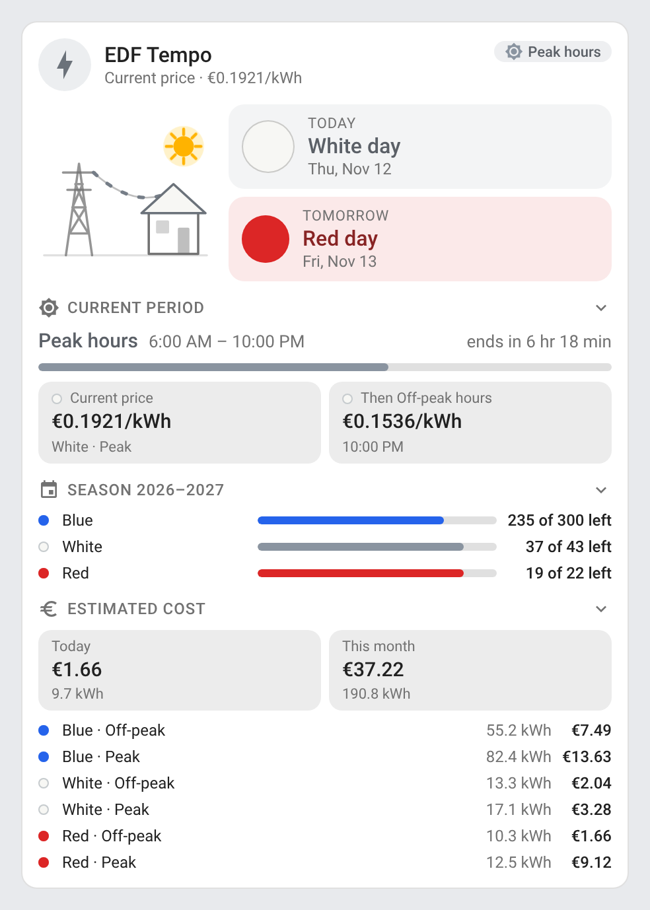 | 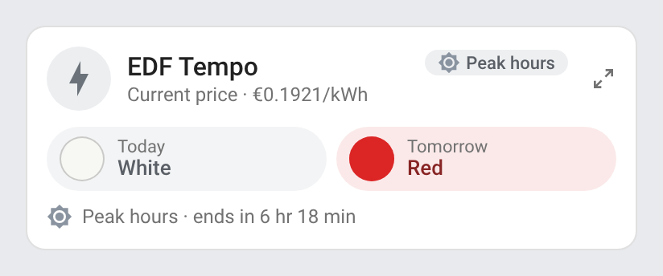<br>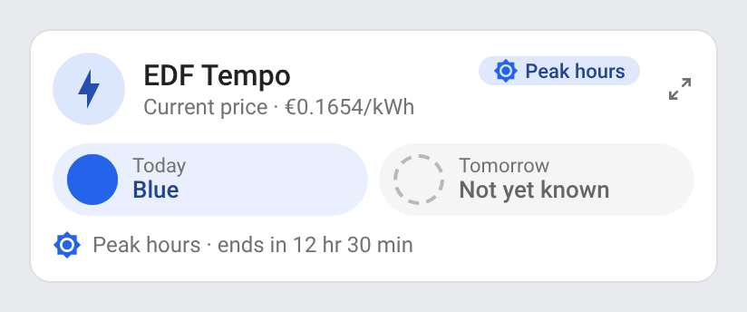 |

## Features

- Two cards: a full **Tempo Card** (`custom:tempo-card`) and a compact **Tempo Mini Card** (`custom:tempo-mini-card`)
- Color of **today and tomorrow**, with the date of each Tempo day (a Tempo day runs from 06:00 to 06:00); tomorrow shows *Not yet known* until RTE publishes it
- Animated scene: a pylon feeds a house under the sky of the period, the current flows faster as the day gets dearer, and a warning flashes on a red day at peak hours (see [Animations](#animations))
- **Current period** (off-peak or peak hours) with its hours, a progress bar and a countdown to the next change, the current price per kWh and the price of the next period (with tomorrow's color when the next period starts the next Tempo day)
- **Days left** of each color in the season (1 September to 31 August: 22 red, 43 white, the rest blue), with bars
- **Estimated cost** of today and of the month, per color and period, from the long-term statistics of the six Tempo meter indexes and a price grid (EDF regulated prices by default, numbers or price entities), with an optional monthly subscription
- Header icon and status chip in the color of the day; the chip tells the current period
- Collapsible sections (period, season, cost): click a section title to fold or unfold it, a click elsewhere folds them back
- Detail button on the mini card (top right): it switches the mini card to the full card's content and back; a click anywhere outside the card brings the compact view back
- Click any value to open its Home Assistant history (more-info dialog)
- Visual editor in the dashboard UI for both cards (no YAML needed)
- Light and dark mode, English, French, German, Spanish, Serbian (Cyrillic and Latin), Italian, Dutch, European Portuguese, Polish, Romanian, Danish, Swedish, Bulgarian, Russian, Ukrainian, Hungarian, Slovak, Czech, Slovenian, Latvian and Greek
- Single file, no external dependency

## Supported integrations

| Integration | What the cards read |
|---|---|
| [RTE Tempo](https://github.com/hekmon/rtetempo) (custom, `rtetempo`) | Color of today and tomorrow, **days left** of each color, off-peak flag and next off-peak change |
| [Tarif EDF](https://github.com/delphiki/hass-tarif-edf) (custom, `tarif_edf`, Tempo contract) | Color of today and tomorrow (its calendar-day sensors, read as Tempo days: before 06:00, yesterday's and today's), **Tempo prices** of the six periods (used as the price grid) |
| [EDF Tempo](https://github.com/chrisbansart/ha_tempo) (custom, `tempo`) | Color of today and tomorrow and current period (attributes of its sensor) |
| [Linky TIC](https://github.com/hekmon/linkytic) (custom, `linkytic`) | Historic mode: the six Tempo indexes (`BBRHCJB` … `BBRHPJR`), current period (`PTEC`) and tomorrow's color (`DEMAIN`); standard mode: indexes `EASF01`-`EASF06`, the tariff label (`LTARF`) and the colors of today and tomorrow from the status register (`STGE`) |
| [ZLinky_TIC](https://www.zigbee2mqtt.io/devices/ZLinky_TIC.html) in Zigbee2MQTT (`mqtt`) | Indexes `current_tier1`-`6_summ_delivered`, current period (`active_register_tier_delivered` / `current_price`) and tomorrow's color (`tomorrow_color`) |
| Any other entity | Set `today_entity`, `tomorrow_entity`, `offpeak_entity`, `indexes`, `prices` or `days_left` (templates, utility meters, other integrations…) |

When several integrations provide the same information, the Tempo services come first (RTE Tempo, Tarif EDF, EDF Tempo), then the meter. The cost needs meter indexes recorded in the long-term statistics (energy sensors with a `state_class`, as all of the above are). Details in [How it works](#how-it-works).

## Prerequisites

Home Assistant 2024.8 or later, with at least one of the [supported integrations](#supported-integrations) configured, or entities of your own giving the Tempo colors.

## Installation

### Via the Marketplace (recommended)

Click the button below to add the repository directly:

[](https://my.home-assistant.io/redirect/marketplace_repository/?owner=juju35&repository=ha-tempo-card&category=plugin)

Then click **Install**, and reload your browser when the Marketplace asks you to.

Or manually:

1. Open **Settings → Marketplace → Add from link** (top right; this needs a GitHub account connected)
2. Add `https://github.com/juju35/ha-tempo-card` — Type: **Dashboard**
3. Open **Tempo Card** and click **Install**
4. Clear your browser cache and refresh

The Marketplace adds the resource `/local/community/ha-tempo-card/tempo-card.js` for you.

### Manual

1. Download `tempo-card.js` and the `tempo-card.i18n.*.js` translation files from the [latest release](https://github.com/juju35/ha-tempo-card/releases/latest)
2. Copy them all to `/config/www/` (without the translation files, the cards show in English)
3. Go to **Settings → Dashboards → ⋮ → Resources** → Add resource:
   - URL: `/local/tempo-card.js`
   - Type: **JavaScript Module**
4. Clear your browser cache and refresh

## Configuration

### Card types

| Card | Type |
|---|---|
| Tempo Card | `custom:tempo-card` |
| Tempo Mini Card | `custom:tempo-mini-card` |

### Visual editor

Edit a dashboard, click **Add card** and search for **Tempo Card** or **Tempo Mini Card**. The entities found are used as they are; pick others if you wish, set the off-peak hours, the sections to display, the meter indexes, the price grid, the subscription and the language. The preview updates live, and options left at their default are kept out of the generated YAML.

### Minimal

```yaml
type: custom:tempo-card
```

```yaml
type: custom:tempo-mini-card
```

### Full options

```yaml
type: custom:tempo-card
title: Tempo
today_entity: sensor.rte_tempo_couleur_actuelle
tomorrow_entity: sensor.rte_tempo_prochaine_couleur
offpeak_entity: binary_sensor.rte_tempo_heures_creuses
offpeak_hours: "22:00-06:00"
show_period: true
show_season: true
show_cost: true
collapsed:
  - cost
days_left:
  blue: sensor.rte_tempo_cycle_jours_restants_bleu
  white: sensor.rte_tempo_cycle_jours_restants_blanc
  red: sensor.rte_tempo_cycle_jours_restants_rouge
indexes:
  blue_hc: sensor.linky_index_tempo_blue_days_off_peak_hours
  blue_hp: sensor.linky_index_tempo_blue_days_peak_hours
  white_hc: sensor.linky_index_tempo_white_days_off_peak_hours
  white_hp: sensor.linky_index_tempo_white_days_peak_hours
  red_hc: sensor.linky_index_tempo_red_days_off_peak_hours
  red_hp: sensor.linky_index_tempo_red_days_peak_hours
prices:
  blue_hc: 0.1356
  blue_hp: 0.1654
  white_hc: 0.1536
  white_hp: 0.1921
  red_hc: 0.1615
  red_hp: sensor.tarif_rouge_tempo_heures_pleines_ttc
subscription: 15.80
currency: EUR
language: fr
```

```yaml
type: custom:tempo-mini-card
title: Tempo
zoom: true
language: fr
```

### Options reference

| Option | Card | Default | Description |
|---|---|---|---|
| `title` | both | `EDF Tempo` (translated) | Card title |
| `show_title` | both | `true` | Show the title in the header |
| `show_subtitle` | both | `true` | Show the subtitle (current price) under the title |
| `today_entity` | both | Discovered | Entity giving today's color: any state or spelling the supported integrations use (`Bleu`, `BLANC`, `red`, `HPJR`, `HC BLEU`…) |
| `tomorrow_entity` | both | Discovered | Entity giving tomorrow's color (`BLEU`/`BLAN`/`ROUG`, `----` or `inconnu` while unknown) |
| `offpeak_entity` | both | Discovered | Binary sensor on during off-peak hours, or an entity giving the tariff period (`HC`/`HP`, `HCJB`, `HP ROUGE`…) |
| `offpeak_hours` | both | `22:00-06:00` | Off-peak hours, one range or several (`"12:30-14:30, 23:00-07:00"` or a list), for the period bounds and the countdown (and the period itself without `offpeak_entity`) |
| `zoom` | mini | `true` | Detail button at the top right of the mini card: it shows the full card's content (with the same options) and switches back; a click outside the card also brings the compact view back. `false` removes the button |
| `show_period` | full | `true` | Current period: hours, progress, countdown, current and next price |
| `show_season` | full | `true` | Days left of each color in the season (needs days left entities, RTE Tempo) |
| `show_cost` | full | `true` | Estimated cost of today and of the month (needs meter indexes) |
| `collapsed` | full | `[]` | Sections folded by default, among `period`, `season` and `cost` |
| `days_left` | both | Discovered | Entities of the days left: `blue`, `white`, `red` |
| `indexes` | both | Discovered | Meter indexes (kWh, Wh or MWh, recorded in the statistics): `blue_hc`, `blue_hp`, `white_hc`, `white_hp`, `red_hc`, `red_hp` |
| `prices` | both | EDF regulated prices | Price per kWh of each period, same keys as `indexes`: a number or a price entity. Without it, Tarif EDF's prices when installed, otherwise the EDF regulated Tempo prices incl. VAT of 1 August 2026 (0.1356 / 0.1654 blue, 0.1536 / 0.1921 white, 0.1615 / 0.7295 red, off-peak / peak, CRE deliberation 2026-147); a price entity that is unavailable falls back to these |
| `subscription` | both | — | Monthly subscription, added to the month's cost (and its daily share to today's) |
| `currency` | both | `EUR` | Currency of the prices |
| `language` | both | Auto | Force language: `fr`, `en`, `de`, `es`, `sr`, `sr-Latn`, `it`, `nl`, `pt`, `pl`, `ro`, `da`, `sv`, `bg`, `ru`, `uk`, `hu`, `sk`, `cs`, `sl`, `lv` or `el` (auto-detects from HA settings) |

> [!NOTE]
> Check the default prices against your bill: they change a few times a year, and other suppliers sell Tempo-like offers at other prices.

## Screenshots

### Animations

The scene and the day discs animate with the day and the period; every animation honours `prefers-reduced-motion`.

A blue day at peak hours: the sun turns its rays, the current flows calmly along the line, and today's disc sends out soft ripples:

| Light | Dark |
|---|---|
| 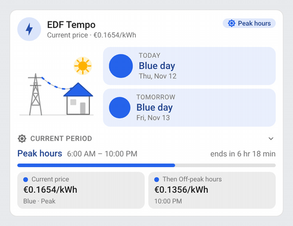 | 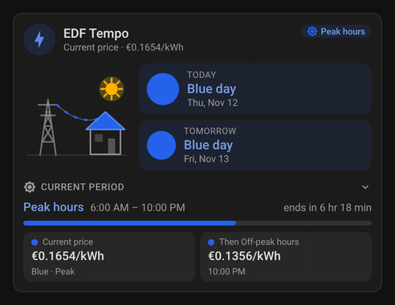 |

A white day: the current flows faster and a light sweeps over today's disc:

| Light | Dark |
|---|---|
| 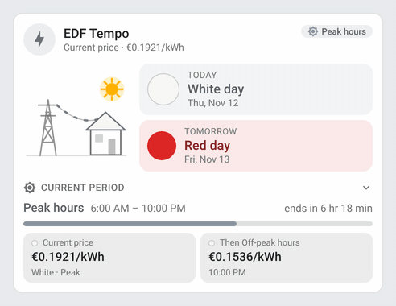 | 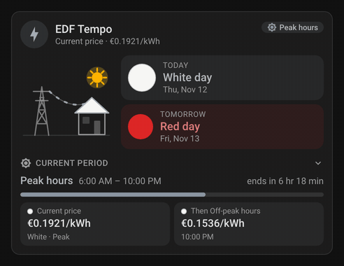 |

A red day at peak hours: the current races in red, a warning bolt flashes on the house and today's disc pulses:

| Dark | Light |
|---|---|
| 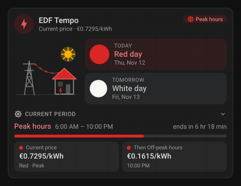 | 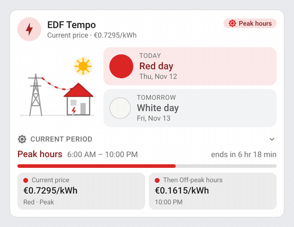 |

Off-peak hours at night: the moon shines among twinkling stars, the window glows and the current slows down:

| Dark | Light |
|---|---|
| 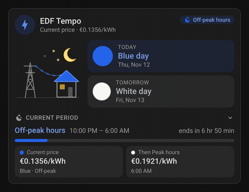 | 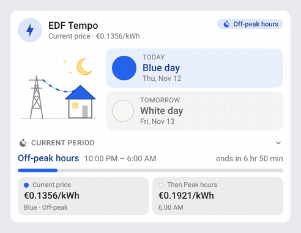 |

In the morning, before RTE publishes tomorrow's color, its dashed disc turns while it waits:

| Light | Dark |
|---|---|
| 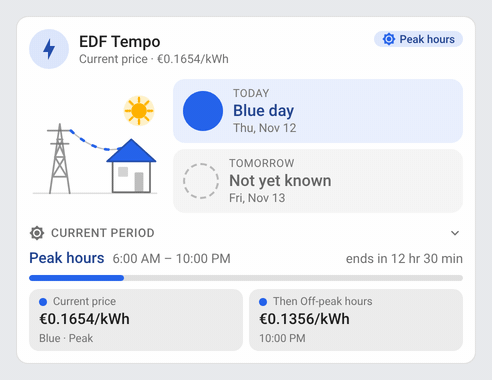 | 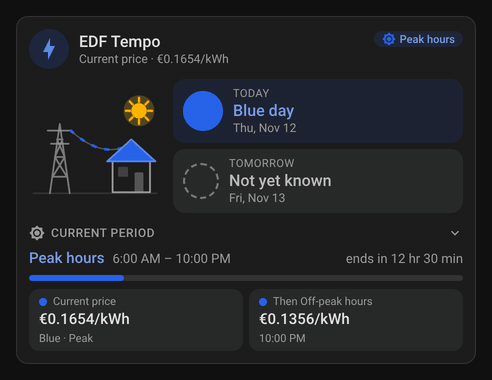 |

### Tempo Card

A white day before a red one, at peak hours, with RTE Tempo and a Linky read by Linky TIC:

| Light | Dark |
|---|---|
|  | 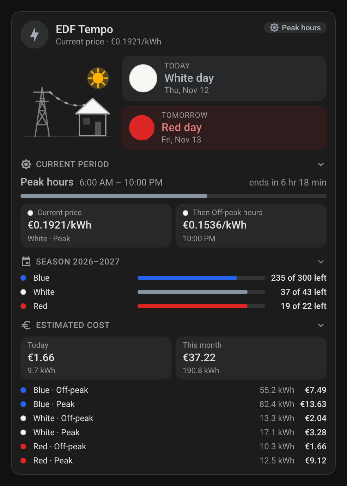 |

With the season and the cost folded (`collapsed: [season, cost]`):

| Light | Dark |
|---|---|
| 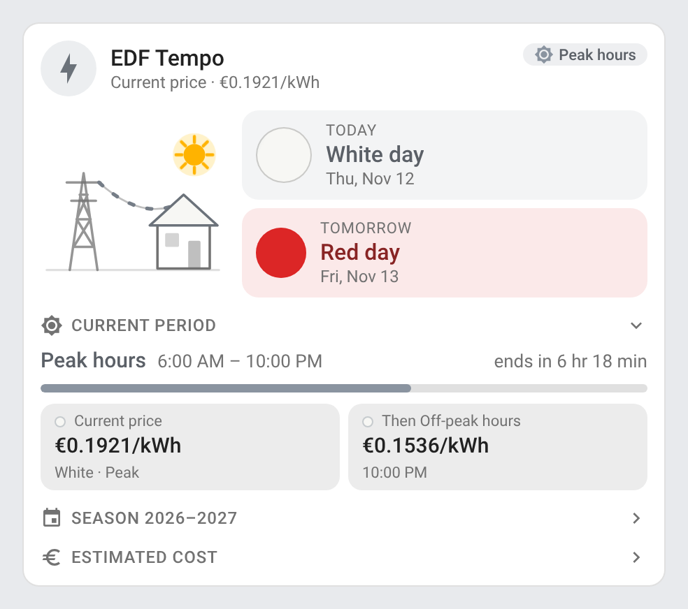 | 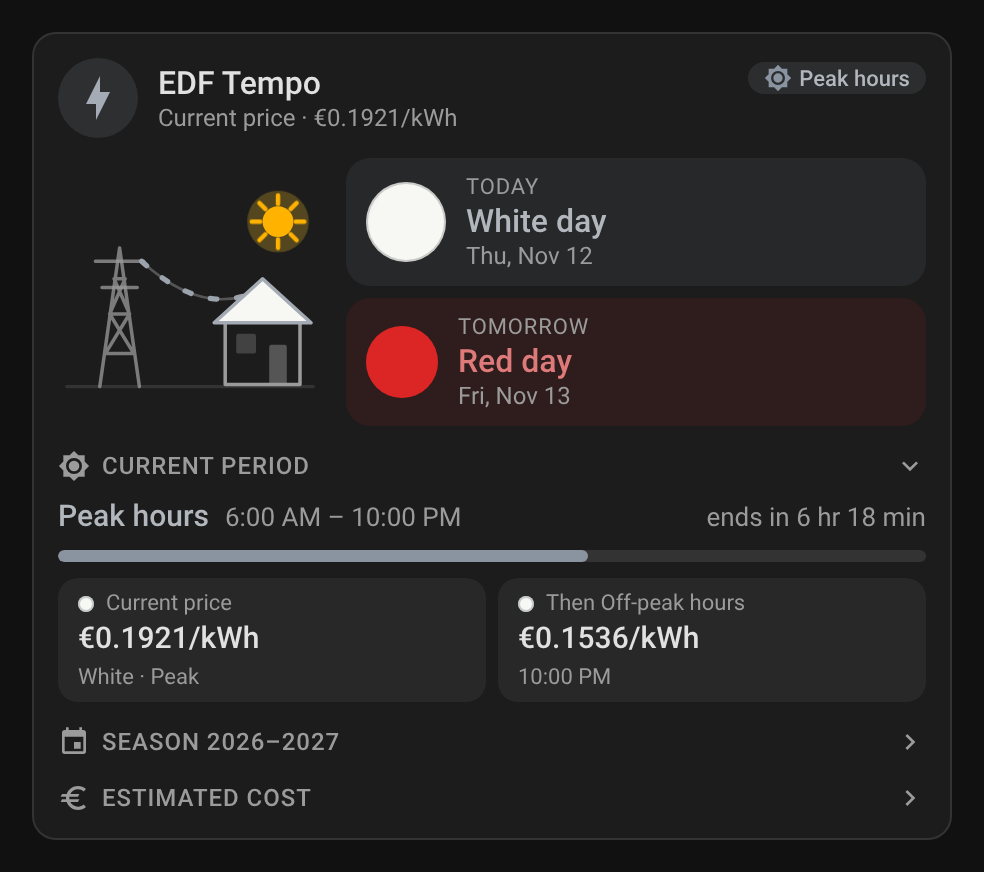 |

### Tempo Mini Card

The two days and the current period; the detail button (top right) opens the full card's content:

| Light | Dark |
|---|---|
|  | 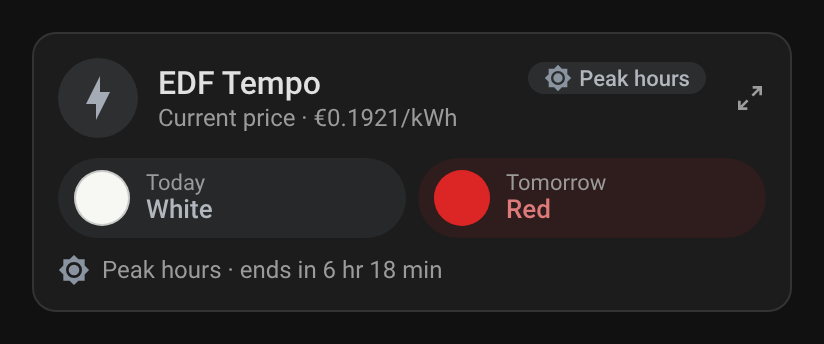 |
| 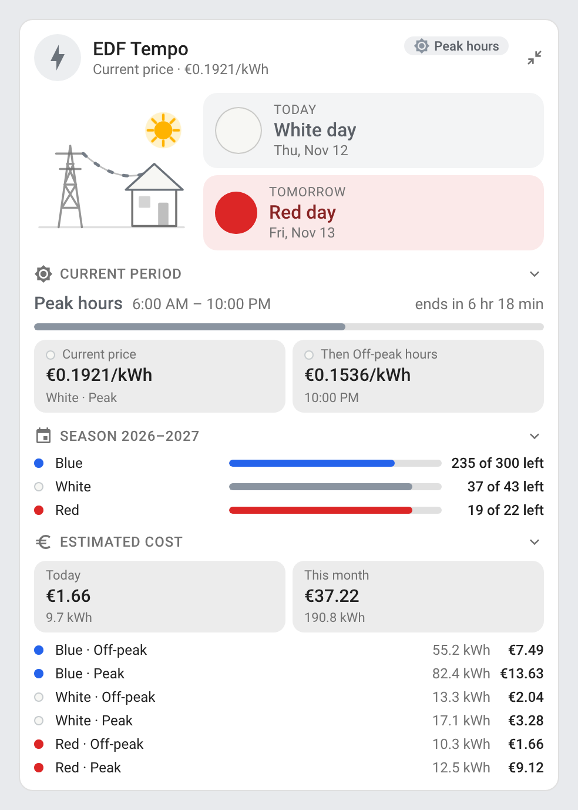 | 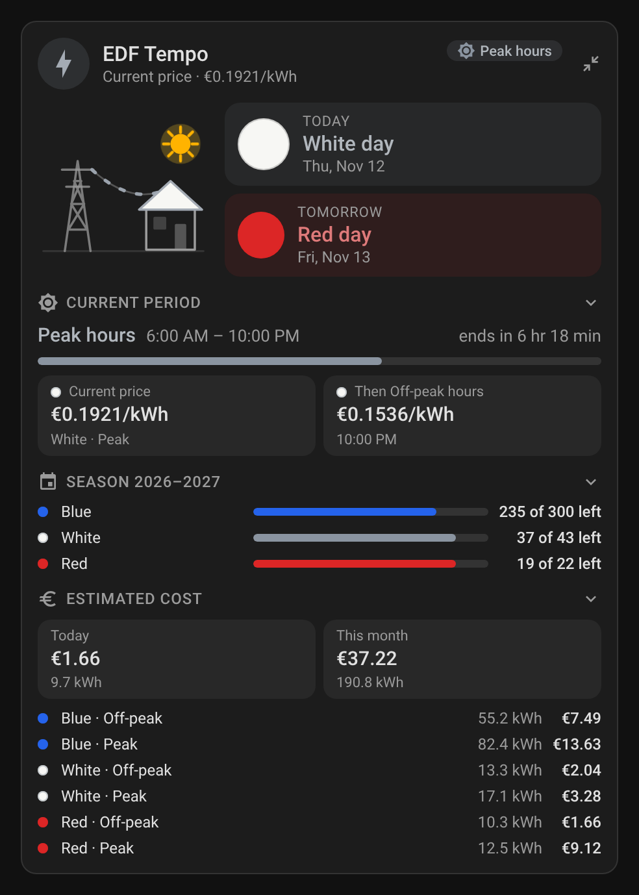 |

Tomorrow not yet known (morning):

| Dark | Light |
|---|---|
| 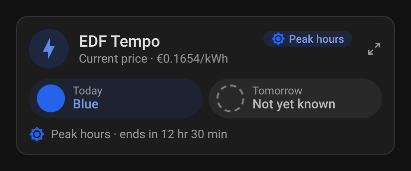 |  |

### Narrow cards

The full card at 6 of 12 columns of a phone's Sections view (the days stack beside a smaller scene, the season bars give way to the counts) and the mini card at 3 columns:

| Light | Dark |
|---|---|
| 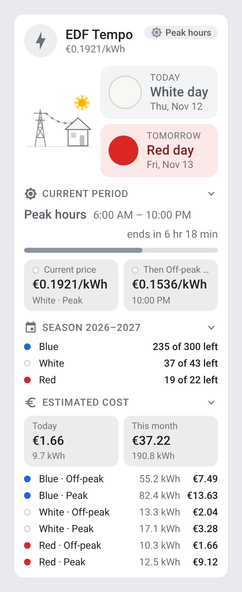 | 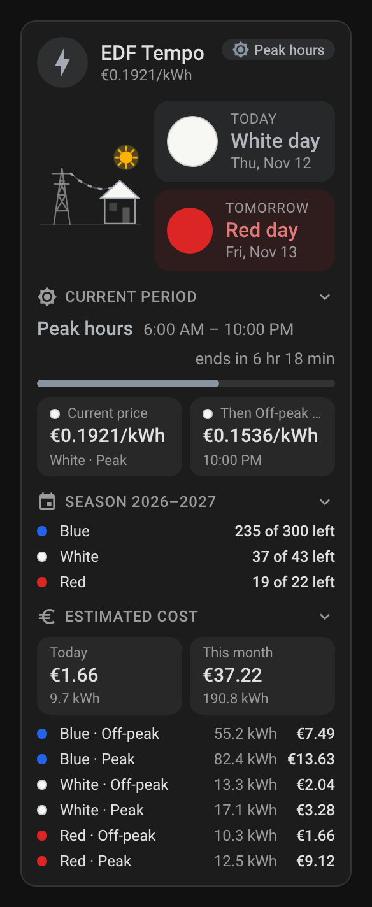 |
| 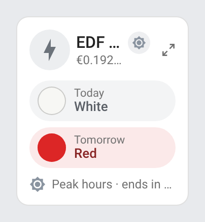 | 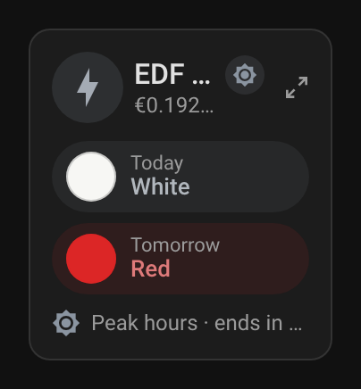 |

## How it works

The cards read the Home Assistant entity registry: every entity of a supported integration is recognized by its integration and its `translation_key` (Linky TIC), its entity id ending (Zigbee2MQTT) or its fixed name (RTE Tempo and Tarif EDF name their entities in French, without translation keys). Colors are read in every spelling these integrations use — `Bleu`, `blanc`, `ROUGE`, `BLEU`/`BLAN`/`ROUG` (`DEMAIN`), `HCJB`…`HPJR` (`PTEC`), `HC BLEU` (`LTARF`), `Bleu HP`, `blue`, `1`-`3` or the colored emoji — so an entity of your own (a template, say) works as long as its state is one of them.

### Period and countdown

The current period comes from `offpeak_entity` (or the integration's flag), otherwise from `offpeak_hours`. The bounds, the progress and the countdown come from `offpeak_hours`, in the time zone of Home Assistant; when the entity disagrees with them (other off-peak hours), the countdown follows the integration's own next change time if it has one (RTE Tempo), and is left out otherwise. The next period's price uses tomorrow's color when it starts with the next Tempo day (at 06:00).

### Season

A Tempo season runs from 1 September to 31 August with 22 red days (1 November to 31 March, weekdays), 43 white days and the rest blue (300, or 301 in a season with a 29 February). The days left come from RTE Tempo's *Cycle Jours restants* sensors (or `days_left`).

### Cost estimation

The energy of each index is read from the long-term statistics (`recorder/statistics_during_period`, daily `change` since the first day of the month), refreshed every five minutes: today's energy is the change since midnight, the month's the change since the first day. Each index is multiplied by the price of its color and period, and the monthly subscription (optional) is added to the month (its daily share to today). Index units in Wh or MWh are converted to kWh by Home Assistant. The result is an estimate: it uses the current prices for the whole month and leaves out taxes billed apart.

## Development

```bash
npm install
npm run build        # bundles src/tempo-card.js into dist/tempo-card.js (+ one translation file per language)
npm run check        # builds and checks the card (run in CI)
npm test             # unit tests (node:test, no browser needed)
npm run screenshots  # renders the cards (and one GIF per animated state, needs ffmpeg) with mock data into screenshots/
```

`dist/` is not committed: `npm run build` creates it locally, CI builds it on every push, and the release workflow attaches the built files to the release, which is where the Marketplace installs them from.

### Releasing

1. Bump `version` in `package.json`
2. Add a `## <version>` section at the top of [CHANGELOG.md](https://github.com/juju35/ha-tempo-card/blob/main/CHANGELOG.md)
3. Push to `main`: the **Release** workflow builds the card, creates the tag and the GitHub release with the changelog section as notes, and attaches `tempo-card.js` and its translation files

## Translations

The cards auto-detect the language from your Home Assistant settings. Currently supported:

| Language | Code |
|---|---|
| English | `en` |
| Français | `fr` |
| Deutsch | `de` |
| Español | `es` |
| Српски | `sr` |
| Srpski (latinica) | `sr-Latn` |
| Italiano | `it` |
| Nederlands | `nl` |
| Português (European; also used for `pt-BR`) | `pt` |
| Polski | `pl` |
| Română | `ro` |
| Dansk | `da` |
| Svenska | `sv` |
| Български | `bg` |
| Русский | `ru` |
| Українська | `uk` |
| Magyar | `hu` |
| Slovenčina | `sk` |
| Čeština | `cs` |
| Slovenščina | `sl` |
| Latviešu | `lv` |
| Ελληνικά | `el` |

Contributions for additional languages are welcome!

## Credits

EDF and Tempo are trademarks of Électricité de France; RTE is Réseau de Transport d'Électricité, publisher of the Tempo calendar; Linky is a trademark of Enedis; ZLinky_TIC is a product of LiXee. This project is not affiliated with EDF, RTE, Enedis or LiXee. Thanks to the authors of the integrations the cards read.

## License

[MIT](https://github.com/juju35/ha-tempo-card/blob/main/LICENSE)

## Support

If you find this project useful, you can support its development:

<a href="https://buymeacoffee.com/julienstep9"></a>
